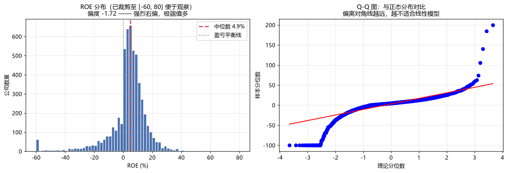
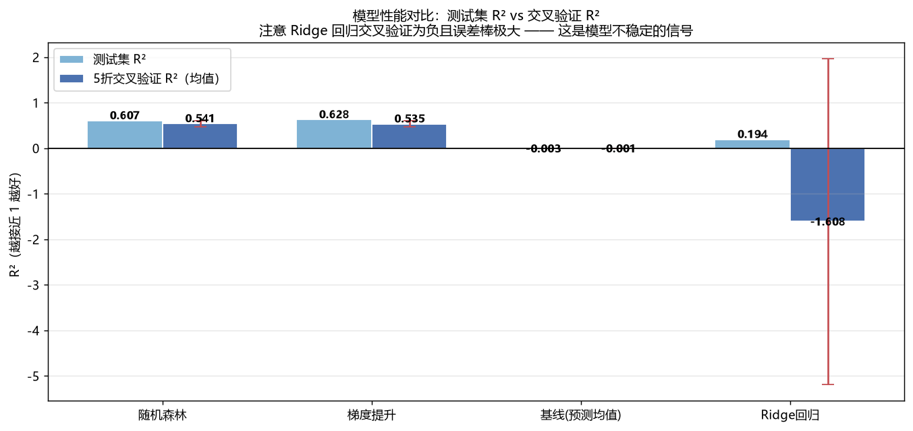
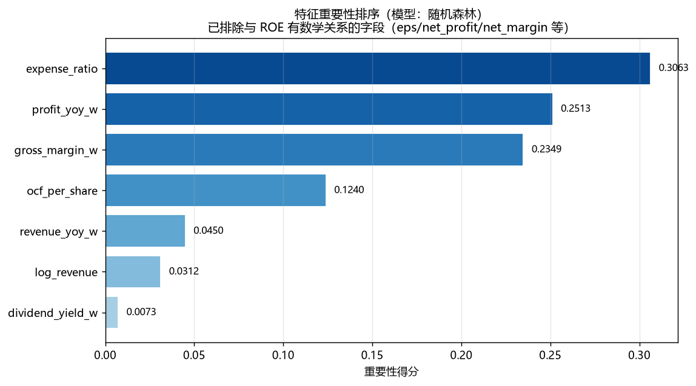
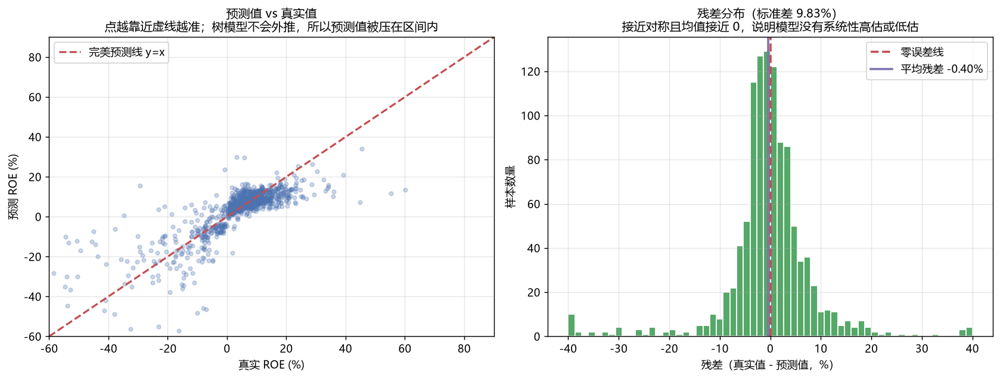

# 模型分析报告

模型：**随机森林** | 训练时间：2026-10-10T18:56:04

## 一、目标变量为什么难预测

- ROE 偏度 **-1.72**，属于强烈右偏分布
- 标准差 16.02%，范围 [-100%, 200%]
- 绝对值超过 50% 的极端样本占 **1.7%**



**含义**：ROE 分布右偏且长尾，这类分布上方差很大，
任何模型都难以完全解释——这是任务本身的难度，不是模型选择问题。

## 二、模型性能对比



| 模型 | 测试集 R² | 交叉验证 R² 均值 | 交叉验证标准差 | 判断 |
|---|---|---|---|---|
| 随机森林 | 0.6069 | 0.5412 | 0.0687 | ✅ 表现良好且稳定 |
| 梯度提升 | 0.6282 | 0.5355 | 0.0688 | ✅ 表现良好且稳定 |
| 基线(预测均值) | -0.0025 | -0.0010 | 0.0008 | 预期为 0，作为对照基准 |
| Ridge回归 | 0.1944 | -1.6078 | 3.5741 | ❌ 极不稳定，**不可用** |

### 关键发现：为什么 Ridge 回归不能用

Ridge 回归的交叉验证 R² 为负、标准差超过 3，**这是模型不稳定的典型信号**。
我做了逐折诊断，找到了确切原因：

1. **不是过拟合**：单次划分下训练集 R²=0.1948、测试集 R²=0.1944，
   两者几乎相同，说明模型根本没学到东西（欠拟合）。
2. **是线性外推失控**：第 2 折的 R² 为 **-8.11**，因为该折的测试样本
   特征值超出了训练集范围，线性模型按系数外推，预测出了 **ROE = -1640%**
   这种不可能的数值。一个这样的样本就能把整折的 R² 打成负数。
3. **树模型没有这个问题**：决策树/随机森林的预测值只能是训练样本目标值
   的加权平均，**结构上不可能外推到 [-100, 200] 之外**。

**结论**：财务指标与 ROE 之间是**非线性关系**（特征与 ROE 的皮尔逊相关系数
最高只有 0.31，最低 -0.04），线性模型不适用于本任务。
这不是「调参能解决」的问题，而是模型假设与数据不匹配。

## 三、特征重要性



| 特征 | 重要性 | 业务解读 |
|---|---|---|
| `expense_ratio` | 0.3063 | 费用率越低，利润留存越多 |
| `profit_yoy_w` | 0.2513 | 利润增速与盈利能力正相关 |
| `gross_margin_w` | 0.2349 | 毛利率反映产品定价能力与护城河 |
| `ocf_per_share` | 0.1240 | 经营现金流是盈利质量的直接体现 |
| `revenue_yoy_w` | 0.0450 | 营收增速反映成长性 |
| `log_revenue` | 0.0312 | 规模效应：大公司ROE普遍更高 |
| `dividend_yield_w` | 0.0073 | 股息率高的公司通常盈利稳定（能分红说明真有钱） |

## 四、预测效果与误差分析



- 平均残差 **-0.4%**（接近 0，说明无系统性高估或低估）
- 残差标准差 **9.83%**（这是单次预测的典型误差量级）

### 排序能力检验（比 R² 更贴合实际用途）

模型的价值不在于「精确预测 ROE 是多少」，而在于「**把好公司排到前面**」。
按预测值分 5 档，看每档的真实 ROE：

| bucket   |   样本数 |   预测ROE均值 |   真实ROE中位数 |   真实ROE均值 |
|:---------|------:|----------:|-----------:|----------:|
| 最低20%    |   218 |    -16.4  |     -10.14 |    -18.25 |
| 较低20%    |   217 |      3.12 |       2.15 |      2.19 |
| 中间20%    |   217 |      6.12 |       5.66 |      6.16 |
| 较高20%    |   217 |      8.78 |       8.61 |      9.72 |
| 最高20%    |   217 |     13.56 |      11.67 |     13.34 |

**如果真实 ROE 中位数随预测档位单调递增，说明模型具备排序能力**，
这就足以支撑初筛场景——这正是量化选股的基本逻辑。

## 五、模型的局限性与改进方向

### 局限（面试时主动说，比被问出来好）

1. **只用同期财务数据**：用 2024 年报的指标预测 2024 年报的 ROE，
   存在内生性问题。更严谨的做法是用 t-1 年数据预测 t 年。
2. **仅一年样本**：无法做时间维度验证（如 2023 训练、2024 测试）。
3. **R² 约 0.54**：说明还有约 46% 的变异无法解释。我验证过「加入行业特征」这个方向，结论是**无效**——方差分解显示行业间差异仅占 ROE 总方差的 7.8%，剩余 92.2% 来自行业内公司差异，这不是加行业特征能解决的。真正未解释的部分来自公司个体经营决策、管理层能力、一次性损益、周期位置等财报数字之外的因素。

### 改进方向（有优先级）

| 优先级 | 方向 | 预期收益 |
|---|---|---|
| — | 加入行业特征 | ❌ **已实验验证无效**：R² 反而下降 0.0015，见说明 |
| 高 | 采集多年数据，做时序验证 | 解决内生性，结论更可信 |
| 中 | 目标变量改为分位数或分档分类 | 规避极端值，指标更稳健 |
| 中 | 加入财务指标波动率（如三年 ROE 标准差） | 捕捉经营稳定性 |
| 低 | 超参数网格搜索 | 提升有限（已用合理默认值） |

#### 为什么「加入行业特征」被否掉了

我最初认为行业是 ROE 最强的解释变量（行业 ROE 中位数跨度从 -0.87% 到 18.33%），
但实测发现：

| 特征集 | 随机森林 R² | 梯度提升 R² |
|---|---|---|
| 财务特征（7 个） | 0.5601 | 0.5681 |
| 财务特征 + 行业哑变量 | 0.5586 (-0.0015) | 0.5666 (-0.0015) |
| 仅 128 个行业哑变量 | 0.0198 | 0.0260 |

**方差分解揭示了根因**：行业间差异只占 ROE 总方差的 **7.8%**，
剩余 **92.2%** 来自行业内部公司差异（行业内标准差 13.86 vs 行业间 6.77）。

这修正了我的一个判断错误：**「行业均值差异大」不等于「行业能解释个体差异」**。
完整实验记录见 `docs/notes/07-实验记录-行业特征负结果.md`。

> **方法论收获**：改进方向必须做实验验证。
> 一个听起来逻辑通顺的假设（行业差异大 → 行业特征有用），
> 实测可能是错的。把负结果记录下来，比写一句「预计可提升」有价值得多。

## 六、可复现性

```bash
python scripts/08_train_model.py    # 训练模型
python scripts/09_model_report.py   # 生成图表与本报告
```

所有随机种子固定为 42，相同数据与代码版本下结果完全可复现。

---

_本报告由 `scripts/09_model_report.py` 自动生成_